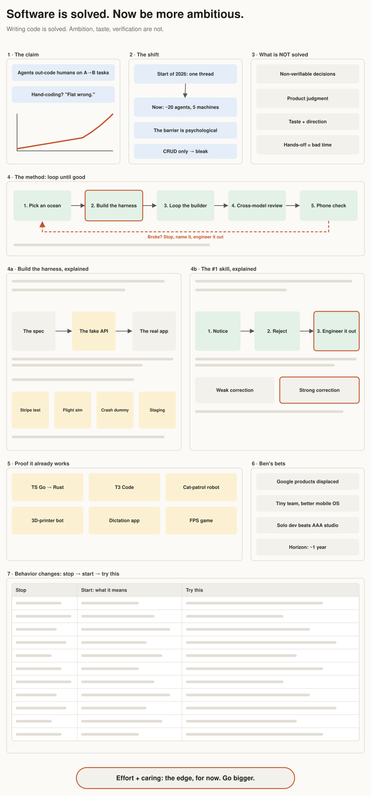

# Software Is Solved: Be More Ambitious

**Live page: https://az9713.github.io/claude-whiteboard-demo/**

An unofficial visual summary of [Ben Davis's video](https://www.youtube.com/watch?v=qfZhblrmSxM) on working with coding agents.

**Writing code is solved. Ambition, taste and verification are not.**

The page covers:

1. **The claim**: agents now out-code humans on any well-specified task
2. **The shift**: from babysitting one agent to running ~20 in the background
3. **What is not solved**: UI taste, product judgment, decisions nobody can check
4. **The method**: a five-step loop, plus deep dives on building a test harness (4a) and the "no, not like this" skill (4b)
5. **Proof**: six projects built mostly by agents running in loops
6. **Ben's bets**: his predictions for the next few years
7. **What to do differently**: stop → start → try-this table
8. **How it was made**: the whiteboard this page grew from, and how each question reshaped it

## View it

[Open the live page](https://az9713.github.io/claude-whiteboard-demo/), or open `index.html` locally in a browser.

It's a single self-contained file with no build step and no dependencies, and it follows your system's light or dark mode.

## Files

- `index.html`: the page
- `board.svg`: map of the whiteboard the page was built from
- `tools/board_svg.py`: script that redraws the board map from its layout

## Notes

Written from the video's auto-generated transcript, so some names may be mistranscribed. The examples in section 7 are the summarizer's, built from the workflow Ben describes. Not affiliated with Ben Davis or any company mentioned.
